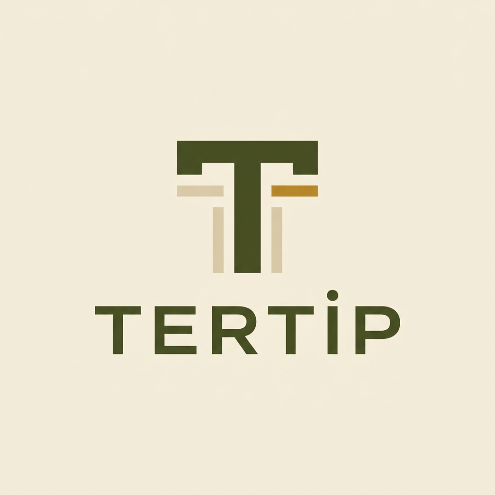
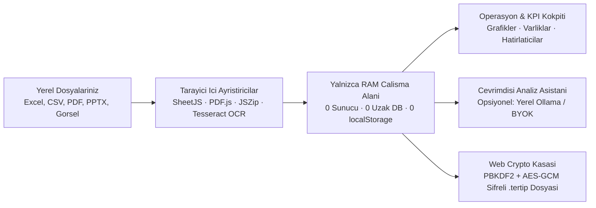

<p align="center">
  
</p>

# Tertip

**%100 yerel, sunucusuz, gizlilik odaklı iş operasyonları, belge analizi, OCR ve raporlama platformu.**

[](./LICENSE)
[](#gizlilik-mimarisi-sifir-sunucu)
[](#hizli-baslangic)

---

## Tertip Nedir? (Ve Neden Bir Not Alma Uygulaması Değildir?)

**Tertip**, hastaneler, klinikler, KOBİ'ler ve operasyon ekipleri için geliştirilmiş **belge tabanlı bir iş zekâsı ve operasyon kokpitidir**.

Serbest metinlerin biriktirildiği klasik bir not alma veya wiki uygulaması **değildir**. Bunun yerine dağınık **Excel, CSV, PDF, PowerPoint ve taranmış görsel belgelerinizi** tarayıcınız içinde saniyeler içinde ayrıştırır; bunları doğrudan yönetilebilir iş verisine dönüştürür:

- **Finansal ve Operasyonel KPI Panosu:** Hasta/işlem hacmi, gelir, gider, net kâr ve kâr marjı trendlerini otomatik çıkarır ve interaktif grafiklerle görselleştirir.
- **Operasyon, Varlık ve Hatırlatıcı Takibi:** Belgelerinizdeki cihaz bakım tarihlerini, SUT rapor son teslim günlerini, finansal takvimleri ve alan/cihaz durumlarını otomatik algılar ve takip listelerine dönüştürür.
- **Çevrimdışı Analiz Asistanı:** *"Bu ay kaç hasta geldi?"*, *"Kâr marjı nedir?"*, *"Yaklaşan bakımlar neler?"* gibi soruları kaynak belge ve rakam atıflarıyla **%100 çevrimdışı** yanıtlar (isteğe bağlı olarak yerel **Ollama** veya kendi **Gemini API** anahtarınızla zenginleştirilebilir).
- **Şifreli `.tertip` Kasa Yedekleme:** Uzak veritabanı veya bulut hesabı yoktur; tüm veriler yalnızca RAM'de yaşar ve dilediğinizde **PBKDF2 + AES-GCM** ile parolayla şifrelenmiş tek bir `.tertip` dosyası olarak bilgisayarınıza indirilir.

---

## Gizlilik Mimarisi (Sıfır Sunucu)

Tertip'te hiçbir belgeniz harici bir sunucuya yüklenmez, uzak bir veritabanına yazılmaz ve `localStorage` üzerinde düz metin olarak saklanmaz.



---

## Desteklenen Belge Formatları

| Format | Uzantılar | Motor | Ne Çıkarır? |
| :--- | :--- | :--- | :--- |
| **Elektronik Tablo** | `.xlsx`, `.xls` | `xlsx` (SheetJS) | Sayfa tabloları, sayısal KPI'lar, gelir/gider/hacim zaman serileri |
| **CSV Veri Dosyası** | `.csv` | `xlsx` (SheetJS) | Yapılandırılmış tablolar, dönem bazlı metrikler |
| **PDF Belgeleri** | `.pdf` | `pdfjs-dist` | Sayfa metinleri, bakım/SUT/finans tarihleri ve özetler |
| **Sunum Dosyaları** | `.pptx` | `jszip` (XML ayrıştırıcı) | Slayt sırasına göre metinler, toplantı ve aksiyon maddeleri |
| **Görsel / Tarama (OCR)** | `.png`, `.jpg`, `.jpeg`, `.webp` | `tesseract.js` (`tur+eng`) | Türkçe ve İngilizce optik karakter tanıma ile taranmış belge metni |

---

## Hızlı Başlangıç

Gereksinimler: [Bun](https://bun.sh/) (`>= 1.1`)

```bash
# 1. Depoyu klonlayın
git clone https://github.com/<kullanici-adiniz>/tertip.git
cd tertip

# 2. Bağımlılıkları yükleyin
bun install

# 3. Geliştirme sunucusunu başlatın
bun run dev
```

Diğer yararlı komutlar:

```bash
bun run typecheck   # TypeScript tip denetimi
bun run build       # Üretim derlemesi (dist/)
bun run preview     # Derlenen paketi yerelde önizleme
```

> **İpucu:** Uygulamayı açtığınızda kendi belgelerinizi sürükleyip bırakabilir veya tek tıkla **Demo Veri Setini Yükle** seçeneğiyle örnek hastane operasyon verilerini inceleyebilirsiniz.

---

## Renk Paleti ve Font Özelleştirme

Tertip'in tüm görsel kimliği tek bir tasarım token dosyasında toplanmıştır: **`src/styles/theme.css`**.

### 1. Renkleri Değiştirme
`src/styles/theme.css` dosyasındaki `:root` (açık tema) ve `[data-theme="dark"]` (koyu tema) bloklarındaki değişkenleri düzenleyerek tüm uygulamanın renk şemasını anında değiştirebilirsiniz:

```css
:root {
  --tertip-bg: #F5EFE3;
  --tertip-surface: #FCF9F2;
  --tertip-surface-elevated: #FFFDF8;
  --tertip-border: #D8C9A8;
  --tertip-ink: #1F2414;
  --tertip-ink-muted: #5C614D;
  --tertip-accent: #4F5B2A;
  --tertip-accent-soft: #E9E4D2;
  --tertip-gold: #B8892D;
  --tertip-success: #3F6212;
  --tertip-warning: #B8892D;
  --tertip-danger: #A63A2B;
}
```

### 2. Özel Font Ekleme
Tertip gizlilik nedeniyle varsayılan olarak harici font sunucularına bağlanmaz. Kendi fontlarınızı kullanmak için:

1. `index.html` içindeki `CUSTOM FONTS HOOK` bölümüne Google Fonts `<link>` satırlarını (veya `public/fonts/` altından yerel `@font-face` tanımınızı) ekleyin.
2. `src/styles/theme.css` içindeki font değişkenlerini güncelleyin:

```css
:root {
  --tertip-font-display: 'Plus Jakarta Sans', system-ui, sans-serif;
  --tertip-font-sans: 'Plus Jakarta Sans', system-ui, sans-serif;
  --tertip-font-mono: 'IBM Plex Mono', ui-monospace, monospace;
}
```

---

## GitHub Pages ile Yayınlama

Depoda hazır bulunan [`.github/workflows/deploy.yml`](./.github/workflows/deploy.yml) iş akışı, `main` dalına her gönderimde uygulamayı Bun ile derleyip otomatik olarak GitHub Pages'e yayınlar.

1. GitHub deponuzda **Settings → Pages** bölümüne gidin.
2. **Build and deployment → Source** seçeneğini **GitHub Actions** olarak ayarlayın.
3. Kodunuzu `main` dalına gönderin (`git push origin main`).
4. (İsteğe bağlı) `index.html`, `public/robots.txt` ve `public/sitemap.xml` dosyalarındaki örnek `https://tertip.github.io/` adresini kendi GitHub Pages veya özel alan adınızla güncelleyin.

---

## English Summary

**Tertip** is a free, open-source, **100% client-side, zero-server business operations and document intelligence platform** built with React 19, TypeScript, Tailwind CSS, and Bun.

- **Not a note-taking app:** Built for operational teams (hospitals, clinics, SMEs) to extract KPIs, charts, asset/facility maintenance schedules, regulatory deadlines, and cited answers directly from raw business documents.
- **Supported formats:** Excel (`.xlsx`, `.xls`), `.csv`, `.pdf`, PowerPoint (`.pptx`), and scanned images via in-browser Turkish + English OCR (`tesseract.js`).
- **True zero-server privacy:** Every file is parsed in browser RAM — zero backend, zero remote database, zero plaintext `localStorage`. Export/import your entire workspace as a password-protected **PBKDF2 + AES-GCM** encrypted `.tertip` file.
- **Easy theming:** Swap brand colors and typography in a single file (`src/styles/theme.css`).
- **Quickstart:** `bun install && bun run dev` — includes automatic GitHub Pages deployment via `.github/workflows/deploy.yml`.

---

## Lisans

Bu proje [MIT Lisansı](./LICENSE) ile lisanslanmıştır.
